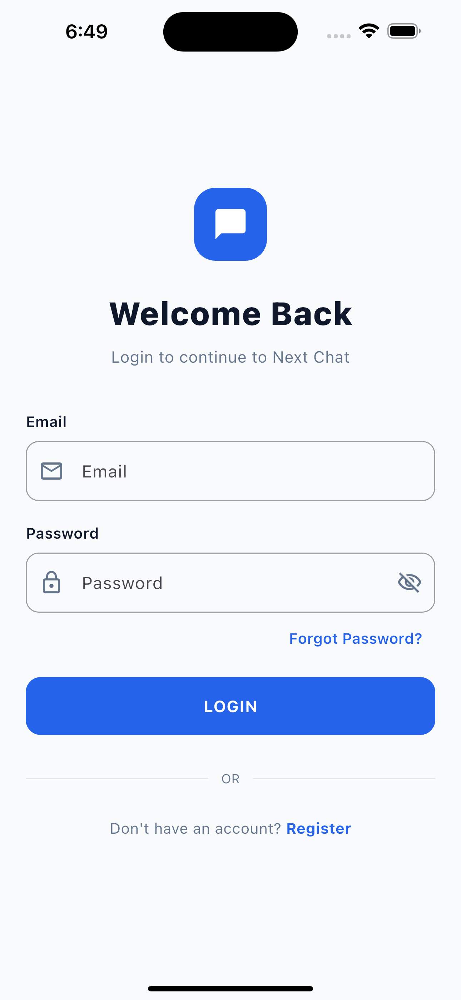
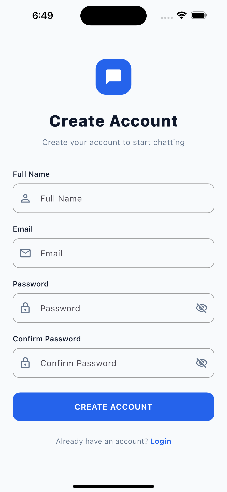
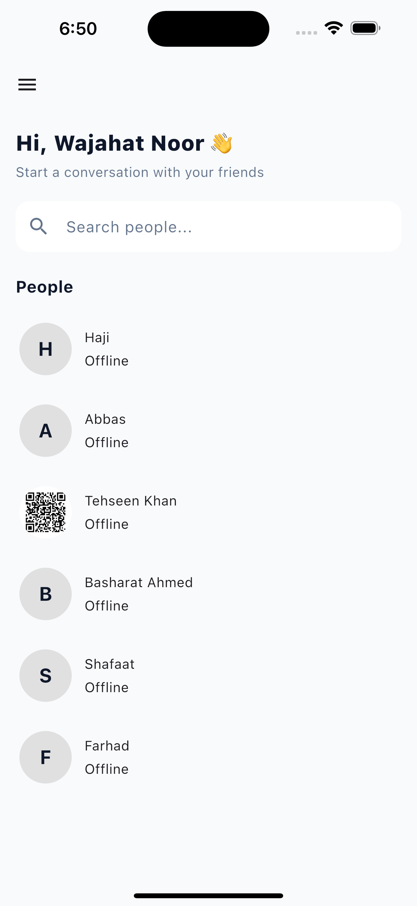
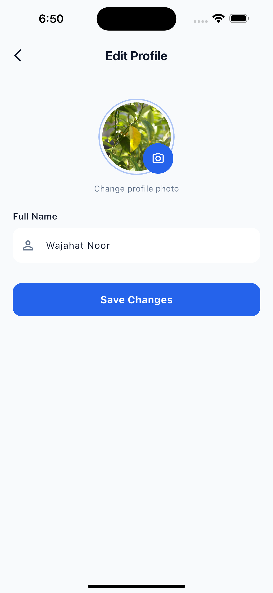
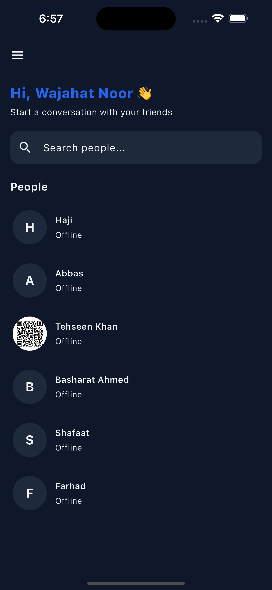

# Next Chat — Real-Time Messaging App

A real-time one-to-one messaging application built with **Flutter and Firebase**, using **BLoC for state management** and **GoRouter for navigation**. This project demonstrates practical mobile app development, clean feature organization, Firebase integration, and responsive UI themes.

## Features

- **Authentication:** User registration and login with Firebase Authentication.
- **Real-Time Messaging:** Send and receive messages using Cloud Firestore.
- **User Discovery:** Search for users and start one-to-one conversations.
- **Profile Management:** View and edit user profile information.
- **Push Notifications:** Firebase Cloud Messaging (FCM) integration.
- **Dark and Light Mode:** Switch between app themes.
- **State Management:** BLoC pattern using `flutter_bloc`.
- **Navigation:** Declarative routing with GoRouter.
- **Firebase Integration:** Cloud-based authentication and real-time data.
- **Reusable UI:** Organized screens, widgets, resources, and utilities.

## Tech Stack

| Technology               | Purpose                           |
| ------------------------ | --------------------------------- |
| Flutter                  | Cross-platform mobile development |
| Dart                     | Programming language              |
| BLoC / flutter_bloc      | State management                  |
| Firebase Authentication  | User authentication               |
| Cloud Firestore          | Real-time messages and user data  |
| Firebase Cloud Messaging | Push notification integration     |
| GoRouter                 | App navigation                    |
| Material Design          | User interface                    |

## Screenshots

### Login Screen



### Register Screen



### Home Screen



### Real-Time Chat


### Edit Profile



### Dark Mode



## Project Structure

```text
lib/
└── app/
    ├── modules/
    │   ├── auth/
    │   ├── home/
    │   ├── chat/
    │   └── profile/
    ├── res/
    └── utils/
```

The application is organized by feature to keep authentication, home, chat, and profile functionality separated and easier to maintain.

_Note: Update the structure above if your actual project folders differ._

## Getting Started

### Prerequisites

- Flutter SDK
- Dart SDK
- Android Studio or VS Code
- A Firebase project

### Installation

Clone the repository:

```bash
git clone https://github.com/WajahatNoor12/next_chat.git
```

Open the project directory:

```bash
cd next_chat
```

Install dependencies:

```bash
flutter pub get
```

Configure Firebase for your Android or iOS application, then run:

```bash
flutter run
```

## Firebase Setup

1. Create a project in the [Firebase Console](https://console.firebase.google.com/).
2. Register your application with the correct package name or bundle identifier.
3. Configure Firebase using the FlutterFire CLI or the official Firebase setup instructions.
4. Enable **Firebase Authentication** and configure your desired sign-in methods.
5. Create a **Cloud Firestore** database and configure appropriate security rules.
6. Configure Firebase Cloud Messaging for push notifications.

**Important:** Never commit private credentials, service-account keys, or sensitive configuration files to a public repository. Ensure Firestore security rules protect user data and conversations.

## Learning Outcomes

Through this project, I practiced:

- Managing application state with BLoC.
- Building real-time features using Cloud Firestore streams.
- Integrating Firebase Authentication and messaging.
- Structuring Flutter applications by feature.
- Implementing navigation with GoRouter.
- Building reusable UI components and dark/light themes.

## Future Improvements

- Server-side notification delivery using Firebase Cloud Functions.
- Improved notification-tap navigation and conversation handling.
- Automated testing and further production hardening.
- Additional messaging features such as media sharing and voice/video calls.

## Author

**Wajahat Noor**  
Flutter Developer | Mobile App Developer

- GitHub: [WajahatNoor12](https://github.com/WajahatNoor12)
- Project Repository: [Next Chat](https://github.com/WajahatNoor12/next_chat)
